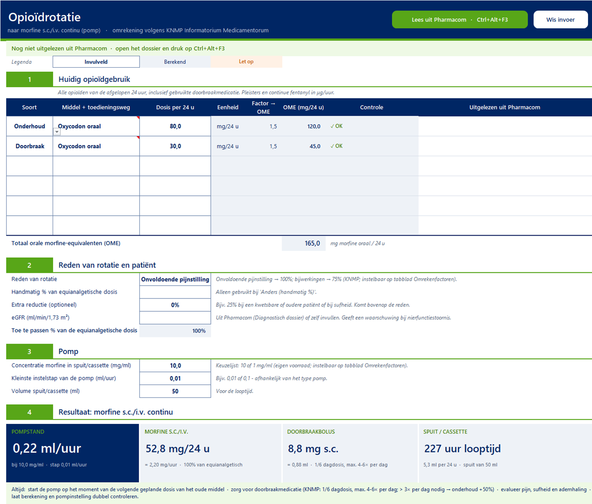
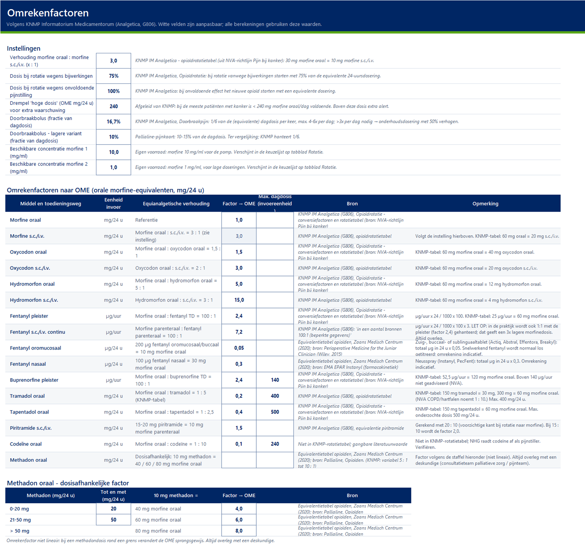

# Opioïdrotatie → morfinepomp

Excel-rekenhulp voor het omzetten van het huidige opioïdgebruik naar **morfine s.c./i.v. continu
(pomp)**: dagdosis, mg/uur, **pompstand in ml/uur** (naar beneden afgerond op de pompstap, dus nooit meer dan berekend), looptijd van de
spuit/cassette en doorbraakbolus. Omrekenfactoren volgens het **KNMP Informatorium
Medicamentorum** (Analgetica → Opioïdrotatie). Optioneel leest hij de huidige opioïden direct uit
het open **Pharmacom**-dossier.

Een hulpmiddel voor apotheekmedewerkers; **geen officieel product** van de KNMP, PharmaPartners,
Health Base of BENU, en **geen medisch hulpmiddel**. Gebruik op eigen verantwoordelijkheid en
controleer altijd (zie [Verantwoording](#verantwoording)).



## Wat het doet

- **Stap 1 – huidig gebruik:** per regel middel + toedieningsweg en dosis per 24 uur (pleisters in
  µg/uur). Wordt omgerekend naar orale morfine-equivalenten (OME), met controle op maximale dagdoses.
- **Stap 2 – reden van rotatie:** onvoldoende pijnstilling (100%, standaard) of bijwerkingen (75%,
  KNMP), eventueel met extra reductie; eGFR voor een waarschuwing bij nierfunctiestoornis.
- **Stap 3 – pomp:** concentratie morfine (keuzelijst, standaard **10 of 1 mg/ml**), kleinste
  instelstap en volume van spuit/cassette.
- **Stap 4 – resultaat:** pompstand, dagdosis morfine s.c./i.v., doorbraakbolus (1/6 dagdosis, KNMP)
  en looptijd, met de berekening in detail en de pompstand bij de andere concentratie.
- **Stap 5 – controles:** alleen de waarschuwingen die van toepassing zijn, bijv. fentanylpleister
  (afgifte 12-24 uur na verwijderen), methadon (dosisafhankelijk, altijd overleg), snelwerkend fentanyl (indicatief), eGFR < 30, hoge dosis, afronding
  te grof (stelt de andere concentratie voor) of spuit binnen 24 uur leeg.
- **Omzetten naar een ander opioïd** (tabblad *Omzetten*): kies bijvoorbeeld *Fentanyl pleister* of
  *Oxycodon oraal*; de rekenhulp neemt de OME en het percentage uit stap 1 en 2 over, rekent de nieuwe
  dosis uit en geeft het best passende preparaat (één sterkte of een combinatie van twee) met
  doseercode, bijv. *Oxycodon tablet MGA 10 mg: 3.1T*, plus doorbraakmedicatie (1/6 van de dagdosis).
  Het assortiment staat op tabblad *Preparaten* (producten volgens de KNMP Kennisbank, Voorschrijfproducten /
  G-Standaard PRK) en is aan te passen aan de eigen voorraad.
- **Uitlezen uit Pharmacom** (optioneel): sneltoets **Ctrl+Alt+F3** vult stap 1 vanuit de
  medicatiestatus (F3) van het open dossier en de **eGFR** (stap 2) vanuit het Diagnostisch dossier
  (Laboratorium uitslagen; nieuwste uitslag, bij voorkeur CKD-EPI).

## Installeren

1. Download `Opioidrotatie-<versie>.zip` bij de nieuwste [release](../../releases/latest).
2. Klik met rechts op de zip → **Eigenschappen** → vink **Blokkering opheffen** aan → OK. (Anders blokkeert
   Excel de macro's in een bestand van internet.) Pak de zip uit.
3. Klik met rechts op `Installeer.ps1` → **Uitvoeren met PowerShell**. De rekenhulp komt in
   `Downloads\Opioidrotatie`, met op het bureaublad de snelkoppelingen **Opioidrotatie morfinepomp**
   en **Lees opioiden uit Pharmacom** (sneltoets Ctrl+Alt+F3). De installatie controleert ook of de
   **Java Access Bridge** (koppeling met Pharmacom) aanstaat en zet hem zo nodig aan; meldt hij dat
   Pharmacom opnieuw gestart moet worden, sluit Pharmacom dan af en open het opnieuw.
4. Open de werkmap en klik eenmalig op **Inhoud inschakelen**.

Open de werkmap niet vanaf een netwerkschijf: daar blokkeert Excel de macro's vaak. Zonder macro's
werkt het rekenblad ook (handmatig invullen); alleen de knoppen niet.

Nodig: Windows 10/11 en Excel (Microsoft 365 / 2019 of nieuwer). Voor het uitlezen: Pharmacom
(32-bit Java) met de Java Access Bridge ingeschakeld (doet de installatie).

## Gebruik

1. Open in Pharmacom het dossier van de patiënt en druk op **Ctrl+Alt+F3** (mag ook vanuit Excel).
   Pharmacom komt naar voren, zo nodig wordt de medicatiestatus (F3) geopend en stap 1 wordt ingevuld.
   Of vul stap 1 met de hand in.
2. Controleer de regels. De kolom *Uitgelezen uit Pharmacom* laat zien wat er gelezen en hoe de
   doseercode vertaald is; **oranje = nakijken**.
   - *Zo nodig / bij pijn* wordt als *Doorbraak* gezet met het **maximum** per 24 uur uit de
     doseercode (bijv. `P1CM6` = bij pijn 1 capsule, niet meer dan 6 per dag). Verlaag naar het
     werkelijke gebruik als dat minder was.
3. Kies de reden van rotatie, de concentratie en de pompstap; lees het resultaat en de waarschuwingen.
4. Klik op **Wis invoer** en sla de werkmap niet op met patiëntgegevens.

## Koppeling met Pharmacom

- Het uitlezen gebeurt met de **Java Access Bridge** van Pharmacom (dezelfde koppeling als de
  [Etiketten autoprinter](https://github.com/ronaldsteenkamp/etiketten-autoprinter)). `Installeer.ps1`
  zet hem zo nodig aan (`jabswitch -enable` uit de Java-map van Pharmacom, of anders zelf
  `%USERPROFILE%\.accessibility.properties`) en controleert of een open Pharmacom hem al gebruikt.
  Met de hand kan het ook: in de autoprinter met **Koppeling inschakelen**, of met
  `jabswitch -enable`; daarna Pharmacom opnieuw starten.
- Alleen lezen: het script stuurt hooguit **F3** (medicatiestatus) en **Alt+I, Alt+D** (Diagnostisch
  dossier, daarna weer F3) naar Pharmacom, alleen als Pharmacom het actieve venster is en er geen
  melding openstaat. De eGFR komt met datum in stap 2; oranje als hij ouder is dan 3 maanden of een
  grenswaarde is (bijv. >90). Er wordt niets bewaard; het tijdelijke bestand wordt
  direct verwijderd. Bovenaan het rekenblad staat welk dossier is uitgelezen.
- **Waarom een sneltoets en geen knop?** Op veel werkplekken mogen macro's in Office geen andere
  programma's (zoals PowerShell) starten; dat is een beveiliging tegen macrovirussen. Daarom start
  het uitlezen buiten Excel (`Pharmacom_naar_Excel.ps1`) en geeft het resultaat aan de werkmap. De
  knop in Excel legt dit uit.
- Opioïden worden herkend aan de **ATC-code**, de sterkte aan de etiketnaam (ook combinatiepreparaten
  en drank per ml) en de **doseercode** volgens de systematiek van de Centrale doseertabel
  (frequentie – tijdsaanduiding – hoeveelheid – toedieningsvorm, `M` + getal = niet meer dan).
  Codes die niet herkend worden, kun je toevoegen op het tabblad **Doseercodes**.
- Niet automatisch: buprenorfine sublinguaal (geen KNMP-factor). Methadon en fentanyl
  oromucosaal/nasaal worden wel ingevuld, altijd oranje (nakijken).

## Omrekenfactoren

Naar orale morfine-equivalenten (OME), volgens KNMP IM (afkomstig uit de NVA-richtlijn Pijn bij
patiënten met kanker). Alle factoren en instellingen staan op het tabblad **Omrekenfactoren** en
zijn aan te passen aan het lokale protocol.

| Middel | Verhouding | Voorbeeld: 60 mg morfine oraal = |
|---|---|---|
| Morfine s.c./i.v. | oraal : s.c. = 3 : 1 | 20 mg |
| Oxycodon oraal / s.c. | morfine : oxycodon = 1,5 : 1; oraal : s.c. = 2 : 1 | 40 mg / 20 mg |
| Hydromorfon oraal / s.c. | morfine : hydromorfon = 5 : 1; oraal : s.c. = 3 : 1 | 12 mg / 4 mg |
| Fentanyl pleister | morfine oraal : fentanyl TD = 100 : 1 | 25 µg/uur |
| Buprenorfine pleister | 100 : 1 | 25 µg/uur |
| Tramadol / tapentadol | 1 : 5 / 1 : 2,5 | 300 mg / 150 mg |
| Fentanyl s.c./i.v. | parenteraal morfine : fentanyl = 100 : 1 (beperkte gegevens) | – |
| Fentanyl oromucosaal (zuig-/buccaal-/sublinguaaltablet) ¹ | 200 µg = 10 mg morfine oraal (indicatief) | 1200 µg/24 u |
| Fentanyl nasaal ¹ | 100 µg = 30 mg morfine oraal (indicatief) | 200 µg/24 u |
| Methadon oraal ¹ | 10 mg methadon = 40 mg (0-20 mg/24 u), 60 mg (21-50 mg) of 80 mg (> 50 mg) morfine oraal; KNMP: variabel 5 : 1 tot 10 : 1 | 15 mg (altijd overleg) |

¹ Niet uit de KNMP-rotatietabel, maar uit de [Equivalentietabel opioïden van het Zaans Medisch Centrum](https://www.zaansmedischcentrum.nl/default/assets/File/Equivalentietabel.pdf)
(2020; bronnen: Pallialine voor methadon, *Perioperative Medicine for the Junior Clinician* voor oromucosaal en het
EPAR van Instanyl voor nasaal). De methadonfactor is niet lineair; de staffel staat op het tabblad **Omrekenfactoren**.

Rotatie wegens bijwerkingen: start met 75% van de equivalente dosis; wegens onvoldoende effect:
equivalente dosis. Doorbraak: 1/6 van de dagdosis, max. 4-6× per dag.



## Verantwoording

Equianalgetische tabellen zijn benaderingen met beperkt wetenschappelijk bewijs; incomplete
kruistolerantie, nier- en leverfunctie, leeftijd en comedicatie beïnvloeden de juiste dosis. Deze
rekenhulp **ondersteunt maar vervangt geen klinisch oordeel, lokaal protocol of dubbele controle**.
Controleer de factoren tegen de actuele KNMP-tekst; bij twijfel: consultatieteam palliatieve zorg of
pijnteam. De software wordt geleverd zonder enige garantie (zie [LICENSE](LICENSE)).

De kleuren zijn geïnspireerd op de BENU-huisstijl; dit is geen product van of namens BENU.

## Zelf bouwen

De werkmap wordt gebouwd uit de bronbestanden in [`bron/`](bron):

| Bestand | Inhoud |
|---|---|
| `werkmap_opbouw.py` | opbouw en opmaak van de werkmap (openpyxl) |
| `Pharmacom.bas` | VBA-module: doseercodes vertalen, sterkte herkennen, stap 1 vullen |
| `Bouw_werkmap.ps1` | bouwt `Opioidrotatie_morfinepomp.xlsm` (Excel via COM: VBA + knoppen) |
| `Test_werkmap.ps1` | test codevertaling, sterkteherkenning en invullen (verzonnen gegevens) |
| `Voorbeeld_afbeeldingen.ps1` | PNG-voorbeelden van alle tabbladen |

```
powershell -ExecutionPolicy Bypass -File bron\Bouw_werkmap.ps1 -Installeer
powershell -ExecutionPolicy Bypass -File bron\Test_werkmap.ps1
```

Nodig: Excel met *Toegang tot het objectmodel van het VBA-project vertrouwen* en Python 3 met
openpyxl. Pas de werkmap niet met de hand aan, maar de bronbestanden, en bouw opnieuw.

## Licentie

[MIT](LICENSE).
